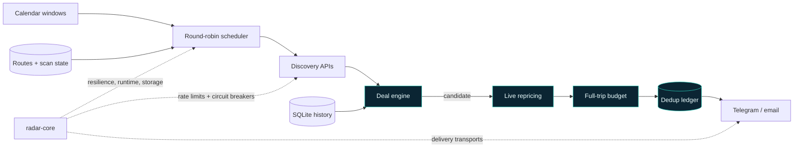

# Vigía

[](https://github.com/Arreketefo/vigia/actions/workflows/ci.yml)
[](https://www.python.org/)
[](LICENSE)

**An always-on travel deal radar that separates real price drops from noisy
market data.**

Vigía continuously scans flight and hotel prices for trips departing from
Alicante (`ALC`). It builds robust historical baselines, identifies meaningful
deviations, validates promising candidates against live inventory and delivers
curated alerts through Telegram or email.

It is built as a long-running service rather than a search form: rate limits,
partial provider failures, duplicate alerts, restarts and stale processes are
all treated as normal operating conditions.

## Why it is different

- **Breadth first.** A rolling 11-month window of route/month pairs is swept
  round-robin against cached market prices.
- **Signal over noise.** Median and median absolute deviation provide a robust
  baseline that is not distorted by a handful of extreme fares.
- **Live confirmation.** Candidates can be repriced against live flight and
  hotel inventory before an alert is sent.
- **Calendar-aware trips.** Seasonal stays, weekend escapes, public holidays
  and local fiestas shape the dates that are actually useful.
- **Operational safety.** Token buckets, backoff, circuit breakers, persistent
  deduplication, health checks and graceful shutdown are built in.

## Architecture



### Detection flow

1. Discovery APIs provide broad but potentially cached market prices.
2. Each route and month is compared with its trailing median and MAD.
3. Relative-drop and absolute-price rules produce a candidate.
4. Optional live providers confirm a bookable flight and hotel price.
5. Full-trip budget rules and the dedup ledger decide whether to alert.

## Example alert

Synthetic example — no account or production data:

```text
✈️ Alicante → Budapest · 5 nights
€128 return / person · 34% below the trailing median
Live trip estimate: €412 for 2 travellers
Window: Fri 16 Oct → Wed 21 Oct
Confidence: 14 historical observations
```

## Stack

Python 3.12 · asyncio · httpx · APScheduler · SQLite/aiosqlite ·
pydantic-settings · Docker Compose · pytest · Ruff · mypy

Shared lifecycle and resilience primitives come from
[`radar-core`](https://github.com/Arreketefo/radar-core). Domain contracts,
provider adapters, calendar rules and deal decisions remain in this repository.

## Quick start

Requirements: Python 3.12+, [`uv`](https://docs.astral.sh/uv/) and Git.

Clone both repositories side by side. `make install` creates a reviewed local
snapshot of the shared core inside Vigía's ignored `vendor/` directory.

```bash
git clone https://github.com/Arreketefo/radar-core.git
git clone https://github.com/Arreketefo/vigia.git
cd vigia

cp .env.example .env
make install
make db-init
make seed
make test
```

The default configuration can run without live confirmation providers. Add API
credentials only for the sources you want to enable; see
[`.env.example`](.env.example) for every setting.

Run one controlled scan:

```bash
make tick
```

Run the scheduler in the foreground:

```bash
make dev
```

## Docker

```bash
make build
make up
make logs
```

The SQLite database lives in a named volume. It contains the historical signal
used by the detector, so deployments must preserve that volume.

## Configuration

Configuration is environment-driven and prefixed with `VIGIA_`. Important
groups include:

- origin, party size and flight/full-trip budgets;
- scan horizon, batch size and cadence;
- country and maximum-duration filters;
- seasonal, weekend and holiday windows;
- minimum sample size and anomaly thresholds;
- optional live flight/hotel confirmation;
- Telegram, email and daily digest delivery.

Never commit `.env`. Credentials must be sent in request headers or bodies, not
placed in URLs.

## Quality

```bash
make test     # 84 focused tests
make lint     # Ruff + strict mypy
make package  # wheel + source distribution
make check    # all local quality gates
```

Tests use synthetic fixtures and mocked HTTP transports; they do not require
production credentials or paid API calls.

## Reliability guarantees

- Provider quotas are enforced independently.
- `429`, `5xx` and transport errors use bounded retries with jitter.
- Repeated provider failures open a cooldown circuit.
- Ticks cannot overlap.
- Shutdown waits for an in-flight tick to finish.
- Alerts are deduplicated persistently across restarts.
- Health checks verify recent useful work, not merely a live process.
- Configuration changes through Telegram are allowlisted and validated.

## Security

See [`SECURITY.md`](SECURITY.md). Use synthetic data in bug reports and never
include booking references, credentials, chat identifiers or personal travel
plans.

## Contributing

See [`CONTRIBUTING.md`](CONTRIBUTING.md) for the development workflow and the
boundary between reusable infrastructure and Vigía's domain logic.

## License

Licensed under the [Apache License 2.0](LICENSE).
